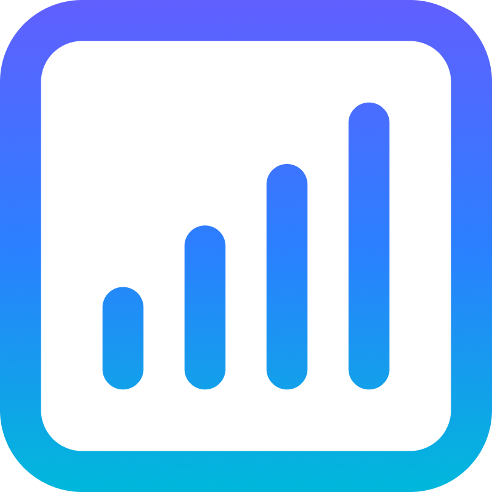

<div align="center">
  <p align="center">
    <a href="https://github.com/cyrildewit/eloquent-viewable">
      
    </a>
  </p>
  <h3 align="center">Eloquent Viewable</h3>
  <p align="center">
    A minimalistic analytics package for Laravel with seamless view tracking for Eloquent models
  </p>
  <br/>
  <p align="center">
    <a href="https://packagist.org/packages/cyrildewit/eloquent-viewable"></a>        
      <a href="https://packagist.org/packages/cyrildewit/eloquent-viewable"></a>
      <a href="https://github.com/cyrildewit/eloquent-viewable/actions"></a>
      <a href="https://packagist.org/packages/cyrildewit/eloquent-viewable"></a>
      <a href="https://codecov.io/gh/cyrildewit/eloquent-viewable"></a>
  </p>
</div>
<hr/>

## Introduction

**Eloquent Viewable** is a flexible and minimalistic analytics package for Laravel that allows seamless tracking of
views for Eloquent models. Rather than incrementing a single counter, it stores each view as its own database record,
so you can analyze totals, unique visitors, and custom time periods entirely within your own application. Whether
you're running a blog, an e-commerce store, or a custom Laravel application, this package lets you log and analyze
views without relying on external analytics services.

Once installed, you can track and retrieve views effortlessly:

```php
// Record a view
views($post)->record();

// Return total view count
views($post)->count();

// Return unique view count of the past 7 days, compared with the 7 days before
views($post)->unique()->period(Period::pastDays(7))->compare();

// Daily counts for a chart
views($post)->period(Period::pastDays(30))->countByInterval(Granularity::Day);
```

### Key Features

- Track **total** and **unique** views for any Eloquent model, from a controller, a route middleware or the browser
  when the page comes from a full-page cache
- Query views by custom periods, compare with the previous period and group them **per hour, day, week, month or year**
- Order and filter models by views, rank the **most viewed content** across every model, and find what's **trending
  right now**
- Show what **people who viewed this also viewed**, and **recommend** to each viewer what the visitors of the models they
  viewed recently went on to view, with the reason for every recommendation
- Know **who viewed what** by linking views to the signed-in user
- Show **who is looking right now**, "12 people are viewing this", with a live counter on cached pages
- Prevent duplicate views with a configurable **cooldown system**
- Count unique visitors **without a cookie**, with a daily rotating fingerprint
- Ignore views from **crawlers, blocked IPs, prefetches, and visitors who opt out** with Do Not Track, Global Privacy
  Control or a setting on their account
- Scale with **caching, queued recording or a Redis buffer**, and test with `Views::fake()`

## Documentation

Everything else is on the documentation site: **[cyrildewit.github.io/eloquent-viewable](https://cyrildewit.github.io/eloquent-viewable/)**.

- [Quick start](https://cyrildewit.github.io/eloquent-viewable/getting-started/quick-start/), from an empty install to a trending list
- [Recording](https://cyrildewit.github.io/eloquent-viewable/recording/), [Counting](https://cyrildewit.github.io/eloquent-viewable/counting/) and [Rankings and recommendations](https://cyrildewit.github.io/eloquent-viewable/rankings/)
- [Viewers and dimensions](https://cyrildewit.github.io/eloquent-viewable/viewers/), [Testing](https://cyrildewit.github.io/eloquent-viewable/testing/), [Scaling](https://cyrildewit.github.io/eloquent-viewable/scaling/) and
  [Extending](https://cyrildewit.github.io/eloquent-viewable/extending/)
- [Recipes](https://cyrildewit.github.io/eloquent-viewable/recipes/), complete features built from the [samples](samples)
- The [configuration](https://cyrildewit.github.io/eloquent-viewable/reference/configuration/), [Artisan commands](https://cyrildewit.github.io/eloquent-viewable/reference/commands/) and
  [events](https://cyrildewit.github.io/eloquent-viewable/reference/events/)

## Getting Started

### Version Compatibility

| Package Version                                                            | Laravel    | PHP  |
|----------------------------------------------------------------------------|------------|------|
| [9.x](https://packagist.org/packages/cyrildewit/eloquent-viewable#9.x-dev) | 13.x       | 8.5+ |
| [8.x](https://packagist.org/packages/cyrildewit/eloquent-viewable#8.x-dev) | 13.x       | 8.5+ |
| [7.x](https://packagist.org/packages/cyrildewit/eloquent-viewable#7.x-dev) | 6.x – 13.x | 7.4+ |

On MySQL the package needs version 8.0 or newer, for the window function the rollups of a [dimension](https://cyrildewit.github.io/eloquent-viewable/viewers/dimensions/) rank
their values with. MariaDB, Postgres and SQLite have one on every version Laravel supports.

The package supports [Laravel Octane](https://laravel.com/docs/octane). Nothing about one request, such as its
visitor, viewer, cooldowns or config, carries over to the next request a worker handles.

### Installation

Install the package via Composer, publish the migrations and run them:

```bash
composer require cyrildewit/eloquent-viewable:^9
php artisan vendor:publish --provider="CyrildeWit\EloquentViewable\EloquentViewableServiceProvider" --tag="migrations"
php artisan migrate
```

This publishes six migrations, one per table: the views table and the tables that retention, rollups, pairs,
milestones and spikes use. Those features stay off until you configure them, so their tables stay empty until then. You
can delete the migration of a feature you will not use before running it. Publishing again adds only the migrations
whose files are missing.

Optionally publish the config file:

```bash
php artisan vendor:publish --provider="CyrildeWit\EloquentViewable\EloquentViewableServiceProvider" --tag="config"
```

Once it is set up, [`php artisan views:doctor`](https://cyrildewit.github.io/eloquent-viewable/scaling/checking-your-setup/) checks the setup and says what to fix.

See [Installation](https://cyrildewit.github.io/eloquent-viewable/getting-started/installation/) for models keyed by a UUID or ULID, and
[Preparing your model](https://cyrildewit.github.io/eloquent-viewable/getting-started/preparing-your-model/) for the next step.

## Upgrading

Please see [UPGRADING](UPGRADING.md) for detailed upgrade guide.

## Changelog

Please see [CHANGELOG](CHANGELOG.md) for more information on what has changed recently.

## Contributing

Please see [CONTRIBUTING](CONTRIBUTING.md) for details.

## Credits

- **Cyril de Wit** - _Author_ - [cyrildewit](https://github.com/cyrildewit)

See also the list of [contributors](https://github.com/cyrildewit/eloquent-viewable/graphs/contributors) who
participated in this project.

## License

This project is licensed under the MIT License - see the [LICENSE](LICENSE) file for details.
