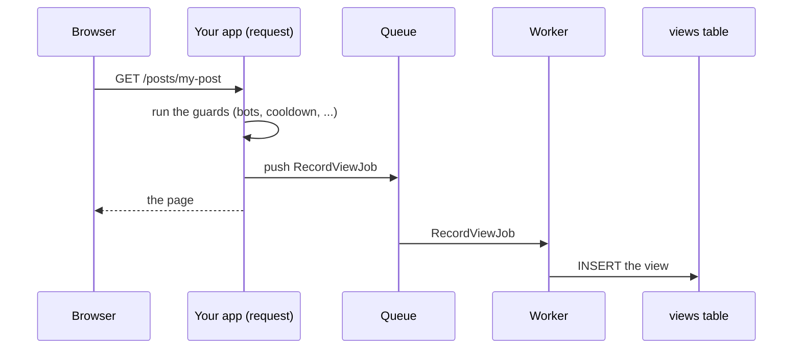

Recording a view is one `INSERT` into the `views` table. That is fast, but it still happens while the visitor waits for
the page. On a busy page, or with a database under load, you can hand the insert to a
[queue worker](https://laravel.com/docs/queues) instead, so the response goes out straight away.

## How it works



Everything that needs the request still happens during it: the guards decide whether the view counts, the cooldown is
started, and the visitor, viewer, [context](/eloquent-viewable/recording/context/) and
[dimensions](/eloquent-viewable/viewers/dimensions/) are captured, along with the time of the view. Only the insert
waits for the worker. So a bot or a view on cooldown is never queued, and a view that lands a minute late still
carries the time it happened.

## 1. Make sure a worker runs

Queueing needs a queue connection that a worker processes, such as `database` or `redis`. If you haven't set one up,
follow [Laravel's queue guide](https://laravel.com/docs/queues) first, then start a worker:

```bash
php artisan queue:work
```

On the `sync` connection, Laravel's default in a new app, a job runs during the request anyway, so you gain nothing.
[`php artisan views:doctor`](/eloquent-viewable/scaling/checking-your-setup/) warns you when that is the case.

## 2. Queue every view

Turn queueing on in `config/eloquent-viewable.php`:

```php
'recording' => [
    'queue' => [
        'enabled' => true,
        'connection' => null, // null uses the default queue connection
        'queue' => null,      // null uses the connection's default queue
    ],
],
```

To keep views apart from your other jobs, give them a queue of their own, `'queue' => 'views'`, and start a worker
for it with `php artisan queue:work --queue=views`.

## Or queue only some views

Leave the config off and choose per call:

```php
views($post)->queue()->record();      // queued, even with queueing off
views($post)->queue(false)->record(); // stored now, even with queueing on
```

The middleware and the browser beacon take it as an argument:

```php
Route::get('/posts/{post}', ShowPost::class)
    ->middleware(RecordViews::using('post', queue: true));
```

## What `record()` returns

`record()` returns `true` as soon as the view is queued, before the worker has stored it. To tell the two apart, use
`attempt()`:

```php
$result = views($post)->queue()->attempt();

$result->recorded; // true
$result->queued;   // true, the worker stores it
```

A count read right after a queued view may not include it yet.

## In the worker

:::caution
A queued view dispatches `ViewRecorded` from the worker, where the session, cookies, `request()` and `auth()` are
unavailable. Read what you need from `$event->record`, which carries the viewer and the context captured during the
request:

```php
use CyrildeWit\EloquentViewable\Recording\Events\ViewRecorded;

Event::listen(function (ViewRecorded $event) {
    $event->record->viewerId;           // not auth()->id()
    $event->record->context['source'];  // not request('utm_source')
});
```
:::

A job that fails is retried and ends up in `failed_jobs` like any other, following your worker's `--tries` setting.

## Queueing or the Redis buffer?

Both take the insert out of the request. Queueing still inserts one row per view, so the database does the same amount
of work, just later. The [Redis buffer](/eloquent-viewable/scaling/redis-buffer/) collects views in Redis and lands them
in batches, which also takes the load off the database. Use one or the other: with the buffer on, leave queueing off.
