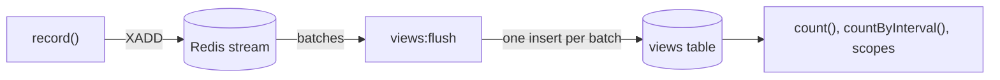

The `redis` store replaces the insert during the request with one `XADD` to a Redis stream. A scheduled command moves
the buffered views into the `views` table, a thousand rows per insert statement.



Setting it up takes three steps:

1. Run Redis 7 or newer, with the `phpredis` extension or Predis 3.3+ (`composer require predis/predis`).
2. Switch the store:

   ```php
   'recording' => [
       'store' => [
           'driver' => 'redis',
           'redis' => [
               'connection' => null, // a connection from database.redis, null is the default one
           ],
       ],
   ],
   ```

3. Schedule the flush:

   ```php
   Schedule::command('views:flush')->everyMinute()->withoutOverlapping();
   ```

`views:flush --batch=500` sets the batch size, and `Recording\Jobs\FlushBufferedViewsJob` does the same from a job.
Running several flushers at once is safe.

What to know:

- **Counts lag until the next flush**, because they read the `views` table.
- **A view may land twice** if a flusher crashes between inserting a batch and acknowledging it.
- **`ViewRecorded` means the stream accepted the view**, not that the row exists yet.
- **Leave `recording.queue.enabled` off**, it gains nothing on top of the buffer.
- **Treat Redis like a queue.** The stream grows until the flusher runs, so monitor `views:flush`. Use
  `maxmemory-policy` `noeviction` or a `volatile-*` policy so Redis never evicts the stream, and enable persistence if a
  restart must not lose up to a minute of views.
