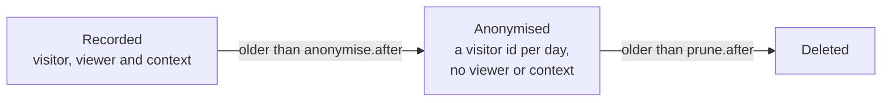
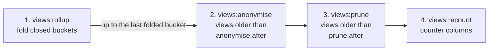

The `views` table keeps every row, with the visitor id, the viewer and the context of each view. A retention policy
anonymises views once they reach one age and deletes them at another. Nothing is set out of the box.



Set the ages in the period shorthand and schedule one command:

```php
'retention' => [
    'anonymise' => ['after' => '30d', 'columns' => ['visitor', 'viewer', 'context']],
    'prune' => ['after' => '1y'],
],
```

```php
Schedule::command('views:maintain')->hourly()->onOneServer();
```

Each run takes the steps below in order and skips the ones that are not configured. The [rollups](/eloquent-viewable/scaling/rollups/) are folded
first, because anonymising and pruning never go past the last bucket they have folded, nor reach views a rollup has
not folded.



`views:anonymise` and `views:prune` run one step, and take `--older-than=90d` in place of the configured age. Every
command takes `--chunk`, and every one but `views:recount` takes `--dry-run`. A dry run of `views:maintain` folds nothing, but counts the views to anonymise and delete
as if its rollups had been folded first, so it reports what the real run would change.

## Keeping each run short

The first run after you turn retention or rollups on, or after `views:rollup --from`, catches up on everything at once.
On a large table that can take longer than the hour until the next scheduled run. Give the run a time limit:

```php
Schedule::command('views:maintain --max-seconds=1800')->hourly()->onOneServer();
```

Once the time is up, the run finishes the bucket, day or chunk it is working on and stops. The next run carries on from
there, in the same order, so a backlog is worked off over a few runs instead of in one very long one. Every maintenance
command takes `--max-seconds`.

On a host that cuts scheduled commands off after a few minutes, such as a serverless platform, dispatch the job
instead. It runs the same steps for at most `maxSeconds` and queues itself again while there is work left:

```php
use CyrildeWit\EloquentViewable\Maintenance\Jobs\MaintainViewsJob;

Schedule::job(new MaintainViewsJob(maxSeconds: 240))->hourly();
```

Keep `maxSeconds` below the timeout of your queue worker. Only one of these jobs waits in the queue at a time.

Anonymising re-hashes `visitor` under a salt per day. The same visitor keeps one id within a day and gets a new one the
next day:

| `viewed_at`    | `visitor` before | `visitor` after | `viewer` and `context` |
|----------------|------------------|-----------------|------------------------|
| 3 March, 09:12 | `5f2a…`          | `a:7f3c…`       | `null`                 |
| 3 March, 17:40 | `5f2a…`          | `a:7f3c…`       | `null`                 |
| 4 March, 08:05 | `5f2a…`          | `a:e19b…`       | `null`                 |

What to know:

- **Anonymising keeps daily uniques exact.** `viewer` and `context` become `null`, and `visitor` is re-hashed under a
  salt per day that is destroyed afterwards. One visitor keeps one id within a day but no id links two days, so
  `anonymise.after` is how far back unique counts across days stay exact. It must not be longer than `prune.after`.
- **A run holds a lock** on the `querying.cache.store` store, so two servers never run at once. A run that is still
  working renews the lock, so a long run keeps it, and the lock of a run that died expires after an hour.
- **A run forgets every remembered count** when it changed a view, and dispatches `Retention\Events\ViewsAnonymised`
  or `ViewsPruned`.
- **A command throws `Retention\Exceptions\RetentionNotInstalled`** when the migrations have not run.
- **Pruning does not return disk space.** MySQL and MariaDB keep the pages of deleted rows for new ones, so the table
  stops growing once pruning keeps up, but does not shrink. It only shrinks after `OPTIMIZE TABLE`, which rebuilds the
  table and locks it on older MySQL versions, or when whole partitions are dropped, see
  [partitioning the views table](/eloquent-viewable/scaling/partitioning/).
