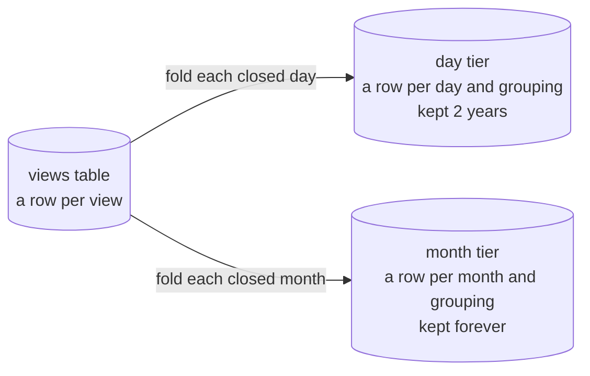
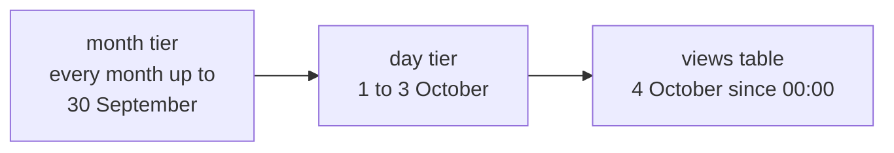

Rollups keep the counts of old views per bucket of time, so history outlives the views it was counted from and
all-time counts read a few rows per model instead of every view. Publish and run their migration, configure the tiers
and read through the `rollup` source:



```php
'querying' => [
    'source' => ['driver' => 'rollup'],
],

'retention' => [
    'rollups' => [
        'tiers' => ['day' => '2y', 'month' => null], // null keeps a tier forever
        'groupings' => ['viewable', 'viewable_collection', 'type'],
    ],
],
```

`views:maintain` folds closed buckets with `views:rollup` before it anonymises and prunes, so the same scheduler line
covers it. `views:rollup` also drops the buckets of a tier past its age, and takes `--tier`, `--from` to fold again
from a date, `--dry-run` and `--chunk`. A tier with an age never folds further back than it is kept, so a first run or
a `--from` refold of a 35-day `hour` tier folds about 35 days of hours. A tier that was never folded starts at the
first view, whatever `--from` says. Every read and scope works through the `rollup` source.

A rollup that starts after views it should count holds anonymising and pruning back until a refold from their date has
folded them, and [`views:doctor`](/eloquent-viewable/scaling/checking-your-setup/) names that date. Such a refold fills the months before the
rollup's rows from anonymised views as well, and leaves the months it already holds alone.

Each grouping answers one kind of count: `viewable` a model, `viewable_collection` a model within a collection, `type`
a whole model type, and `type_collection`, off by default, a type within a collection. A read that needs a grouping
that is not kept, or narrows to a viewer, reads the `views` table alone.

A read splits its period by where each part is kept and adds the parts up. With the tiers above, an all-time count at
15:00 on 4 October reads:



A `unique()` count reads the `views` table as far back as it still holds the original visitor ids, because unique
visitors cannot be added up across buckets exactly.

What to know:

- **Recent views and exact uniques come from the `views` table.** Older history comes from the coarsest tier that
  covers it.
- **Older history has the resolution of its tier.** A bucket counts when its start lies inside the period, and unique
  visitors are summed across buckets. With `retention.rollups.strict` such a read throws
  `Querying\Rollups\Exceptions\ResolutionUnavailable` instead.
- **Nothing is deleted before it is folded.** Anonymising and pruning stop at the last bucket every tier has folded, and
  a tier drops only buckets the next coarser tier has folded. Settings that would break this throw
  `InvalidConfiguration` at boot.
- **Late views are folded again.** A bucket waits `settle`, an hour by default, after it closes, and a view that lands
  later is found by its id and its bucket folded again.
- **A tier removed from a rollup is dropped.** The next `views:rollup` deletes its rows, and `--dry-run` counts them
  first. Added back, it is folded again from the first view still in the `views` table.
- **Destroying views** removes the model's rollup rows, but not its share of the unique visitors of its type.

## Custom rollups

A custom rollup counts only the views a filter keeps, in tiers and groupings of its own and per value of at most one
dimension. It is the only way a value from `context` outlives anonymising.

```php
use CyrildeWit\EloquentViewable\Querying\Rollups\Rollup;
use Illuminate\Database\Eloquent\Builder;

final class NewsletterViews extends Rollup
{
    public string $name = 'newsletter';

    public function tiers(): array
    {
        return ['day' => '2y', 'month' => null];
    }

    public function filter(Builder $views): void
    {
        $views->getQuery()->where('context->source', 'newsletter');
    }

    public function dimension(): ?string
    {
        return 'context->campaign';
    }
}
```

List it under `retention.rollups.custom` and read it with `rollup()`:

```php
views($post)->rollup('newsletter')->period(Period::pastYears(1))->count();
views($post)->rollup('newsletter')->countByDimension(); // ['spring' => 120, 'winter' => 45, '' => 8]
```

What to know:

- **Recent and old counts agree.** `rollup()` reads the `views` table through the same filter, so it works with the
  `database` source too.
- **Keep the dimension small.** Every value is a row per bucket. `groupings()` defaults to `viewable` and `type`.
- **Anonymising and pruning wait for every custom rollup.** `views:rollup --rollup=newsletter` folds one rollup.
- **A source of your own** counts by dimension by implementing `Querying\Contracts\CountsByDimension`, and the fake
  refuses `rollup()`.
